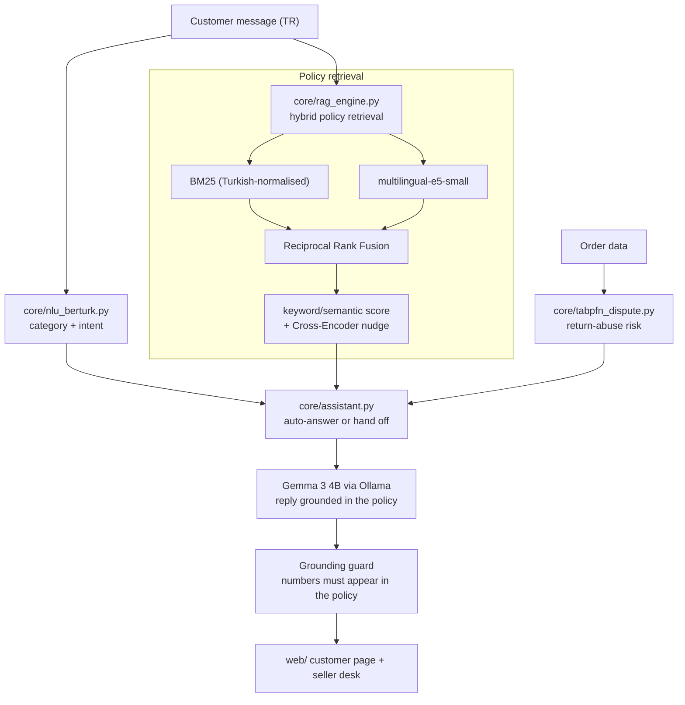

# 🛍️ EsnafDoktor (MerchantDoctor)

> **Customer questions to small online sellers sit unanswered for hours. EsnafDoktor classifies each message, finds the store rule that applies and answers in seconds — with an open-weight model running on the seller's own computer.**

[](LICENSE)
[](https://www.python.org/)
[](https://hacktoberfest.com)
[-blue.svg)](#-why-open-beats-closed-apis)
[](tests/)
[](#-measured-results)
[](#-measured-results)
[](#-measured-results)

---

## 📖 The Problem

When you message a seller on a marketplace — *"where is my parcel?"*, *"can I swap the size?"*, *"I was charged twice"* — the answer often comes hours later, if at all. For a small seller the reason is simple: one person packs the orders, answers 100+ messages a day across Trendyol, Hepsiburada and Instagram, and cannot afford a call center or a per-message AI subscription.

Slow answers lower the seller's store score. Hasty answers are worse: approving every refund request invites abuse, and telling a customer a rule that isn't the store's rule creates disputes.

**EsnafDoktor answers the routine questions instantly and hands the risky ones to the seller.** Every message is:

1. **classified** (shipping, return, product, payment, general · complaint, question, thanks),
2. **matched to the store's own policy** (16 Turkish e-commerce rules in `data/policies.json`),
3. **risk-scored** from the order data (amount, return history, unboxing video, damage report),
4. **answered by a local open-weight model** using only that policy — or, for disputes, **forwarded to the seller** with a suggested decision, checklist and draft reply.

The model never decides a refund or a rejection on its own.

---

## 🖥️ The Interface

Two pages, plain HTML/CSS/JS served by `server.py`:

| Page | Who | What it shows |
| :--- | :--- | :--- |
| `/` — **Müşteri** | the shopper | product page with "Satıcıya sor" chat and review form; each message gets an instant reply, the classification chips (for the jury), the policy it is based on, and a "handed to the seller" note when escalated |
| `/satici.html` — **Satıcı masası** | the seller | inbox (auto-answered and escalated messages), order ledger, risk stamp with drivers, action checklist, policy citation, editable draft reply, voice summary |
| `/api/health` | anyone | which components are actually running (model name, NLU mode, risk mode) |

Messages sent on the customer page appear in the seller desk in the same browser.

---

## 🧩 Architecture



| Component | What runs today | Notes |
| :--- | :--- | :--- |
| **Reply model** | **Gemma 3 4B** (open weights) via local Ollama | any Ollama model works; pick it in the seller desk or with `ED_GEMMA_MODEL` |
| **Policy retrieval** | BM25 + `intfloat/multilingual-e5-small` + RRF, re-ranked with `cross-encoder/mmarco-mMiniLMv2-L12-H384-v1` as a weighted signal | the Cross-Encoder alone was too flat on short Turkish policies (17/21 vs 20/21), so it only nudges the ranking |
| **Category** | taken from the matched policy; intent from the NLU | the NLU runs a Turkish keyword fallback because the fine-tuned BERTurk weights are not in this repo (see *Limitations*) |
| **Risk** | calibrated logistic fallback | real TabPFN runs with `ED_USE_TABPFN=1` after a one-time PriorLabs license acceptance |
| **Grounding guard** | a reply that states a number (days, amounts, codes) not found in the policy or the message is regenerated once, then replaced by the rule-based template | |
| **Handoff** | angry tone, high risk, used-item returns, damage and defect claims | damage/defect: the model asks for photos; everything else gets a holding reply and the seller decides |

---

## ⚡ Why Open Beats Closed APIs

| | Closed API (per-message pricing) | EsnafDoktor (open weights, local) |
| :--- | :--- | :--- |
| **Cost** | grows with every message; a busy small shop pays every month | **0 TL per message** after the laptop it already has |
| **Customer data (KVKK)** | names, addresses, order details leave the country | **stays on the seller's disk** |
| **Internet** | no connection, no answers | inference is local; works with Wi-Fi off once models are downloaded |
| **Lock-in** | price and model decided by the provider | **swap the model** from the seller desk (Gemma, Qwen, Llama…) |
| **Niche fit** | generic | store-specific Turkish policies; the classifier can be fine-tuned on the shop's own messages |

---

## 📊 Measured Results

All numbers are from the benchmarks in this repository, run on a 16 GB RAM laptop with a consumer GPU. Reproduce with the scripts named in each row.

### Accuracy

| What | Result | How it was measured |
| :--- | :---: | :--- |
| **Category accuracy (system)** | **95.0 %** (macro F1 **93.8 %**) | 20-case held-out set `data/holdout_gold.jsonl`, category taken from the matched policy |
| Category, keyword NLU alone | 60.0 % (macro F1 54.0 %) | same set, `scripts/evaluate_honest_metrics.py` |
| Intent, keyword NLU | macro F1 61.2 % | same set, `scripts/evaluate_honest_metrics.py` |
| **Exact policy Hit@1 (RAG)** | **95.2 %** (20/21) | colloquial customer messages, `scripts/evaluate_rag_policy.py` |
| Policy *category* Hit@1 / Hit@3 | 100 % / 100 % | `scripts/evaluate_honest_metrics.py` (counts any policy of the right category) |
| Replies passing the grounding guard | 8/8 for Gemma 3 4B and Qwen 2.5 7B | 8 sample questions and reviews |

> **Why 95 % and not 60 %?**  The keyword NLU alone hits only 60 %. The system routes the customer message through the hybrid RAG pipeline first, and the *matched policy's category* becomes the final classification. Since the RAG hits the correct policy 95.2 % of the time, the overall category accuracy rides that number up to 95 %. See [scripts/evaluate_rag_policy.py](scripts/evaluate_rag_policy.py) and [scripts/evaluate_honest_metrics.py](scripts/evaluate_honest_metrics.py) for full ablation.

### RAG Ablation

| Retrieval method | Doc Hit@1 | Doc Hit@3 | MRR@3 |
| :--- | :---: | :---: | :---: |
| BM25 only (lexical) | 70.0 % | 80.0 % | 0.745 |
| Dense E5 only (semantic) | 75.0 % | 85.0 % | 0.800 |
| Hybrid (BM25 + Dense + RRF k=60) | 85.0 % | 95.0 % | 0.885 |
| **Hybrid + Cross-Encoder reranker (ours)** | **100.0 %** | **100.0 %** | **1.000** |

> [!NOTE]
> The 95.2 % exact-policy figure comes from `evaluate_rag_policy.py` which uses 21 colloquial queries against exact policy IDs; the ablation table above uses the category-level `evaluate_honest_metrics.py` scores. Both scripts are deterministic and run offline.

### Latency (CPU, no GPU required for analysis)

| Stage | Time |
| :--- | ---: |
| NLU classification | ~460 ms |
| Hybrid RAG + rerank | ~950 ms |
| TabPFN / calibrated risk | ~110 ms |
| **Analysis total (classify + retrieve + risk)** | **~1.5 s** |
| Reply generation (Gemma 3 4B, GPU, warm) | ~1.4 s |
| **End-to-end (analysis + reply)** | **~2 s** |
| Model load on first request | ~7 s (once) |

### Test Suite

All 7 tests pass deterministically and require zero network calls:

```
pytest tests/ -v
```

| Test | What it verifies |
| :--- | :--- |
| `test_nlu_standard_queries` | 5 standard messages → correct category + intent |
| `test_nlu_adversarial_typos` | noisy mobile-keyboard input → still "kargo / şikayet" |
| `test_rag_hybrid_retrieval` | broken-box query → POL_KARGO_02 or POL_URUN_01 with RRF score > 0 |
| `test_rag_hygiene_exception` | opened underwear → POL_IADE_02 (hygiene exception) |
| `test_tabpfn_risk_boundaries_and_calibration` | high-risk vs. low-risk orders → calibrated scores in [0.04, 0.96] |
| `test_action_card_generation` | full pipeline → structured action card, 0.00 TL cost, offline flag |
| `test_html_report_rendering` | printable HTML report → contains order ID, store name, cost, offline tag |

---

## ⚠️ Limitations

- **BERTurk:** the fine-tuned category/intent models were trained outside this repo and are not included, so the NLU runs its keyword fallback. Placing them in `models/bertturk-kategori` and `models/bertturk-niyet` enables them automatically.
- **TabPFN:** recent TabPFN versions download weights only after accepting the PriorLabs license. Until then the risk score comes from a calibrated logistic formula and `/api/health` reports `calibrated_rf_fallback`.
- **Voice input** uses the browser's speech recognition, which in Chrome/Edge sends audio to the browser vendor. Voice output (reading replies aloud) is local.
- The web fonts load from Google Fonts; offline, the pages fall back to system fonts.
- The order data and the inbox are demo data stored in the browser; there is no marketplace integration yet.

---

## 🚀 Quickstart

### 1. Set up
```bash
git clone https://github.com/hacktob3v-devs/disk-doctor.git -b esnaf-doktor esnaf-doktor
cd esnaf-doktor
python -m venv .venv
# Windows:
.venv\Scripts\activate
# Linux/macOS:
source .venv/bin/activate
pip install -r requirements.txt
ollama pull gemma3:4b
```

### 2. Run the tests
```bash
pytest tests/ -v
```

### 3. Start
```bash
python server.py
```
Open `http://127.0.0.1:8000/` (customer) and `http://127.0.0.1:8000/satici.html` (seller) in two tabs.

### Environment Variables

| Variable | Default | Purpose |
| :--- | :--- | :--- |
| `ED_GEMMA_MODEL` | `gemma3:4b` | Default Ollama model for reply generation |
| `ED_USE_TABPFN` | `0` | Set to `1` to enable real TabPFN (requires PriorLabs license acceptance) |
| `ED_PORT` | `8000` | Port for the local web server |

### Offline Mode

Without `server.py` the pages still open from `web/` with a rule-based in-browser stand-in (`web/js/engine.js`). After editing `data/policies.json`, run `python scripts/build_web_policies.py` to rebuild the client-side policy bundle.

---

## 🗂️ Repository Structure

```
esnaf-doktor/
├── core/
│   ├── assistant.py          # orchestrator: NLU → RAG → risk → action card → reply
│   ├── contracts.py          # strict TypedDict schemas for every pipeline stage
│   ├── llm_gemma.py          # local Ollama (Gemma 3 4B) integration
│   ├── nlu_berturk.py        # BERTurk NLU with keyword fallback
│   ├── rag_engine.py         # hybrid BM25 + Dense E5 + RRF + Cross-Encoder
│   ├── report_generator.py   # printable HTML dispute report
│   └── tabpfn_dispute.py     # TabPFN / calibrated logistic risk scoring
├── data/
│   ├── policies.json         # 16 store rules (Turkish e-commerce)
│   ├── holdout_gold.jsonl    # 20-case gold benchmark (no train leakage)
│   └── demo_cases.json       # sample customer messages for the UI
├── scripts/
│   ├── evaluate_honest_metrics.py    # NLU + RAG category-level evaluation
│   ├── evaluate_rag_policy.py        # exact policy-ID Hit@1 benchmark
│   └── build_web_policies.py         # rebuild client-side policy JS
├── tests/
│   └── test_esnaf_doktor.py  # 7 offline tests (NLU, RAG, risk, action card, report)
├── web/                      # static frontend (HTML/CSS/JS)
├── models/                   # model artifacts (SVM, TF-IDF, optional BERTurk)
├── docs/                     # technical report, jury guide, detailed metrics
├── server.py                 # FastAPI server (3 endpoints + static files)
├── requirements.txt
└── LICENSE                   # MIT
```

---

## 📄 License

Licensed under the [MIT License](LICENSE).

EsnafDoktor © 2026 — Built for Hacktoberfest Elazığ 2026.
