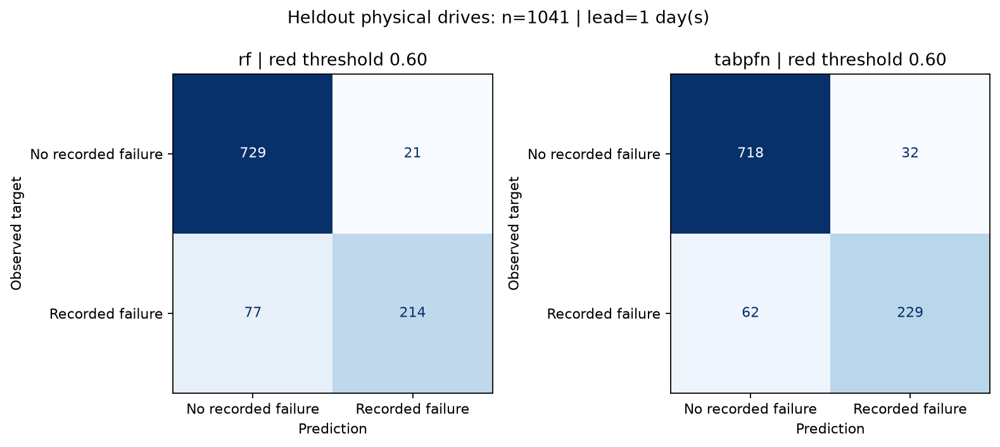

# Disk model: measured evaluation and Person 1 handoff

## Assessment and next decision

The revised drive-disjoint experiment supports a working prototype, not a deployable failure-probability service. The more demanding **June calendar check** drops TabPFN recall to **68.9%**, precision to **80.7%** and ROC-AUC to **0.879** on **1124 drives** (267 positives). RF is close on the calendar check. There is no demonstrated universal TabPFN advantage; RF remains the much cheaper CPU option, while TabPFN is retained for the requested local-model demonstration. The technician must use the result as an advisory score, keep backups, and avoid interpreting it as a calibrated probability.

The calendar check is retrospective: control labels use outcomes from the full quarter. It is a sensitivity analysis, **not** prospective validation. See [calendar report](metrics_temporal.md). Repair-shop outcomes and other periods/manufacturers remain unverified.

## Target and evidence

- Target: SMART snapshot exactly **1 day(s) before a recorded failure**.
- Source: [Backblaze Drive Stats](https://www.backblaze.com/cloud-storage/resources/hard-drive-test-data). Raw data, serials and context stay outside Git.
- Sample SHA-256: `c14bd4b2641f1d82b87aa23cdcb0d99295c4bd2f9f640a98fc8cbb2f729da515`; seed `42`.
- Context: 960 unique drives (480 positive). Holdout: 1041 drives (291 positive). No serial overlap.
- One snapshot per drive, stratified random split by physical drive identity; NOT a chronological, unseen-manufacturer or repair-shop validation.
- Fixed red threshold 0.60, yellow threshold 0.30. Imputation is fitted on context only. Confidence intervals: 300 drive-level bootstrap resamples.
- Negatives have no recorded failure within the available quarter, and were observed at least the target horizon beyond their snapshot. This is not proof of future health.

## Heldout results (red threshold = 0.60)

| Method | Recall (95% CI) | Precision (95% CI) | ROC-AUC (95% CI) | Average precision | Fit s | Holdout batch s |
|---|---|---|---|---|---|---|
| rf | 0.735 (0.679–0.782) | 0.911 (0.876–0.946) | 0.928 (0.908–0.946) | 0.895 | 0.49 | 0.06 |
| tabpfn | 0.787 (0.732–0.831) | 0.877 (0.835–0.913) | 0.927 (0.906–0.947) | 0.897 | 7.50 | 9.50 |

### rf: confusion matrix

| Actual / prediction | Non-red | Red |
|---|---|---|
| No recorded failure | 729 | 21 |
| Recorded failure | 77 | 214 |

| Fixed threshold | Recall | Precision |
|---|---|---|
| 0.30 | 0.883 | 0.651 |
| 0.50 | 0.811 | 0.817 |
| 0.60 | 0.735 | 0.911 |

### tabpfn: confusion matrix

| Actual / prediction | Non-red | Red |
|---|---|---|
| No recorded failure | 718 | 32 |
| Recorded failure | 62 | 229 |

| Fixed threshold | Recall | Precision |
|---|---|---|
| 0.30 | 0.873 | 0.674 |
| 0.50 | 0.832 | 0.754 |
| 0.60 | 0.787 | 0.877 |

## Model availability

- Evaluated selection: **tabpfn**. Set `DD_DISK_MODEL=tabpfn` on the demo laptop.
- RF is the credible classical baseline. No measured result is fabricated for unavailable TabPFN. Default runtime attempts a local checkpoint and warns before using RF.
- TabPFN provisioning: install package, place an official compatible checkpoint at `models/tabpfn-v2-classifier.ckpt` or set `DD_TABPFN_PATH`. Model inference never intentionally downloads weights.
- Tradeoff: TabPFN is retained for the requested local-model demo. Compared with RF, observed recall difference is +0.052 and precision difference is -0.033; compare the CPU batch times above. This is **not evidence of established TabPFN superiority**. Both local paths remain available without API costs.

## How it works (article handoff)

We use Backblaze's daily drive observations to form one snapshot per physical drive. Positive snapshots precede the recorded failure by the stated horizon; controls have no recorded failure in the observed quarter and at least that much follow-up. We freeze a serial-disjoint holdout before evaluation, then retain a bounded training context for each class.

The input consists of five log-transformed SMART error counters, five nonzero flags, temperature and log working hours. Missing values remain missing until a training-only median imputer adds explicit missingness indicators. A classical RandomForest provides the baseline. TabPFN runs locally on CPU with an explicit v2 checkpoint and two estimators; the shared Risk contract records which model actually ran. The saved CSV is the context used to rebuild the model on the demo laptop, not a serialized executable model.

## Honest limitations (copy for the article)

Backblaze data-center HDDs differ from laptop and repair-shop drives. Our sampled case/control mix is enriched for failures: the classifier score is **not a calibrated probability** that a shop customer's drive will fail tomorrow. Random drive-level splitting prevents identity leakage but does not establish performance on future periods or unseen drive models. Missingness and vendor-specific SMART encoding can affect predictions. Some failures have little warning in these counters; a low score is not a safety guarantee and backups remain necessary.

NVMe uses a transparent **heuristic health score**, not the HDD classifier or a measured failure probability. Counter descriptions in `drivers` are observed findings, not causal feature attributions or SHAP explanations. Synthetic NVMe examples are labelled synthetic. Backblaze examples are converted CSV snapshots, not live smartctl captures; demo selection does not measure accuracy.

## Integration for Persons 2 and 3

- Public signatures and shared contracts are unchanged. `load_model()` returns `(classifier, method)`; `parse()` returns `DiskInfo`; ATA uses `predict()`, NVMe uses `nvme_rules.score()`.
- Show **model score** for ATA and **rule-based health score** for NVMe, not a calibrated failure percentage. Customer reports must use the same wording; this requires the owners of `app.py` and `core/report.py`.
- Catch `ValueError` / `FileNotFoundError` at the UI boundary. Do not show green for a failed parse or missing model. A partial NVMe log is at least yellow.
- Copy `models/train_context.csv` to the demo laptop through a private transfer; it is deliberately ignored by Git. Install the recorded dependencies before turning off Wi-Fi.
- Tests: `python -m pytest tests -q` (pytest is a development dependency). These are synthetic boundary/pipeline tests, separate from the real-data metrics above.
- Commands from repo root: `python -m scripts.prepare_backblaze data/data_Q2_2026.zip`; `python -m scripts.train_disk_model --method compare`; `python -m scripts.make_demo_json`.
- Scope: Person 1 modules verified separately; full UI/Gemma flow belongs to Persons 2/3. Live capture evidence, if available, is recorded separately below; these metrics do not imply a Wi-Fi-off UI run or user trial.

## Reproduction environment

- Python 3.13.12; Windows-11-10.0.26200-SP0
- Versions: `{"numpy": "2.5.4", "pandas": "3.0.6", "scikit-learn": "1.9.1", "tabpfn": "9.2.0", "torch": "2.14.1"}`.

## Control sampling and remaining limitations

Sampling rule: serial-hash drive selection; independent serial/date hash selects one eligible snapshot per drive. The largest date group contains **448 of 3000 controls (2026-05-10)**. Snapshots are limited to selected observation days, not all daily observations. This is still a retrospective case/control experiment; prospective temporal and repair-shop validation remain necessary.

| Control snapshot date | Drives |
|---|---|
| 2026-04-01 | 400 |
| 2026-04-14 | 431 |
| 2026-04-27 | 429 |
| 2026-05-10 | 448 |
| 2026-05-22 | 435 |
| 2026-06-04 | 422 |
| 2026-06-17 | 435 |

- Local TabPFN checkpoint SHA-256: `f65a35685aeef42e31b796d9bfa34e68d6fc780bc98e7bff7763802964cf435f`.
- Checkpoint source: [official Prior Labs TabPFN-v2-clf](https://huggingface.co/Prior-Labs/TabPFN-v2-clf). Weights have their own model license, separate from this repository's MIT code license.

## Correction history and measured comparison

The initial sampler wrongly chose the earliest eligible control snapshot; 2,921/3,000 controls fell on one date. The corrected independent drive/date hash now distributes controls over seven dates (400–448 per date). The old experiment is retained in [the historical report](metrics_initial.md).

| Experiment | Model | Recall | Precision | ROC-AUC | Test drives |
|---|---|---|---|---|---|
| Initial: biased control dates | rf | 0.746 | 0.900 | 0.928 | 1041 |
| Initial: biased control dates | tabpfn | 0.797 | 0.853 | 0.930 | 1041 |
| Revised: distributed control dates | rf | 0.735 | 0.911 | 0.928 | 1041 |
| Revised: distributed control dates | tabpfn | 0.787 | 0.877 | 0.927 | 1041 |
| June calendar sensitivity | rf | 0.693 | 0.804 | 0.875 | 1124 |
| June calendar sensitivity | tabpfn | 0.689 | 0.807 | 0.879 | 1124 |

Initial and revised drive-split reports use the same heldout physical-drive IDs with corrected control snapshots, so they are exploratory re-evaluations, not independent confirmation. The sampling defect was corrected without tuning model thresholds or choosing dates for a higher score. Precision across the calendar and random splits also reflects different class mixes.

## Live device and offline verification

- 63 synthetic boundary and pipeline tests passed; these do not measure field effectiveness.
- A genuine read-only NVMe capture succeeded with [official smartmontools 7.5](https://github.com/smartmontools/smartmontools/releases/tag/RELEASE_7_5). The official installer archive was extracted rather than installed; only `--scan` and `-j -a` were used. No disk write, self-test or elevation was performed.
- Captured SMART passed; 34 C, 1,491 operating hours, 4% wear, spare 100%, critical warning 0 and media errors 0. Unique identifiers stay in ignored raw data and are removed from the exported demo.
- Both model comparisons and the revised three-demo journey ran with socket connections blocked. The demo journey took 15.23 s in this run, including cold local model loading.
- `healthy_hdd.json`: green, score 0.081428, method `tabpfn`. These illustrative examples do not measure accuracy.
- `failing_hdd.json`: red, score 0.999647, method `tabpfn`. These illustrative examples do not measure accuracy.
- `my_nvme.json`: green, score 0.050000, method `nvme_rules`. These illustrative examples do not measure accuracy.
- Full Gemma/Streamlit integration, Wi-Fi-off UI rehearsal and a repair-shop user trial remain for Persons 2/3 and the team.

## Demo laptop handoff

The ignored local `models/person1_demo_bundle.zip` contains `train_context.csv`, the official local checkpoint, and evaluation metadata. Transfer privately to the demo laptop and extract into its `models/` directory; install the recorded project dependencies before going offline. Data and model weights are deliberately absent from the Git branch.

Bundle SHA-256: `116d25b4a6d48faa0a94a05c150173be83377f91d0674b27b6feb097e3580dea`.
