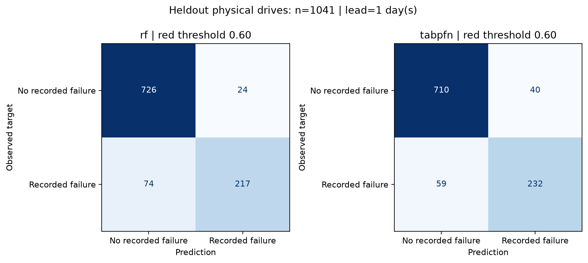

# Historical experiment: earliest-date control bias

This is the INITIAL, biased-sampling experiment, retained for transparency. Use metrics.md for the revised experiment.

# Disk model: measured evaluation and Person 1 handoff

## Target and evidence

- Target: SMART snapshot exactly **1 day(s) before a recorded failure**.
- Source: [Backblaze Drive Stats](https://www.backblaze.com/cloud-storage/resources/hard-drive-test-data). Raw data, serials and context stay outside Git.
- Sample SHA-256: `5881c2b57102a0f01ef43527ff0dc7b0af8eb666e67973fe375ad9756ba169d6`; seed `42`.
- Context: 960 unique drives (480 positive). Holdout: 1041 drives (291 positive). No serial overlap.
- One snapshot per drive, stratified random split by physical drive identity; NOT a chronological, unseen-manufacturer or repair-shop validation.
- Fixed red threshold 0.60, yellow threshold 0.30. Imputation is fitted on context only. Confidence intervals: 300 drive-level bootstrap resamples.
- Negatives have no recorded failure within the available quarter, and were observed at least the target horizon beyond their snapshot. This is not proof of future health.

## Heldout results (red threshold = 0.60)

| Method | Recall (95% CI) | Precision (95% CI) | ROC-AUC (95% CI) | Average precision | Fit s | Holdout batch s |
|---|---|---|---|---|---|---|
| rf | 0.746 (0.688–0.795) | 0.900 (0.857–0.937) | 0.928 (0.908–0.948) | 0.897 | 0.49 | 0.09 |
| tabpfn | 0.797 (0.743–0.846) | 0.853 (0.809–0.895) | 0.930 (0.910–0.950) | 0.900 | 5.89 | 9.39 |

### rf: confusion matrix

| Actual / prediction | Non-red | Red |
|---|---|---|
| No recorded failure | 726 | 24 |
| Recorded failure | 74 | 217 |

| Fixed threshold | Recall | Precision |
|---|---|---|
| 0.30 | 0.880 | 0.653 |
| 0.50 | 0.811 | 0.846 |
| 0.60 | 0.746 | 0.900 |

### tabpfn: confusion matrix

| Actual / prediction | Non-red | Red |
|---|---|---|
| No recorded failure | 710 | 40 |
| Recorded failure | 59 | 232 |

| Fixed threshold | Recall | Precision |
|---|---|---|
| 0.30 | 0.866 | 0.706 |
| 0.50 | 0.832 | 0.773 |
| 0.60 | 0.797 | 0.853 |

## Model availability

- Evaluated selection: **tabpfn**. Set `DD_DISK_MODEL=tabpfn` on the demo laptop.
- RF is the credible classical baseline. No measured result is fabricated for unavailable TabPFN. Default runtime attempts a local checkpoint and warns before using RF.
- TabPFN provisioning: install package, place an official compatible checkpoint at `models/tabpfn-v2-classifier.ckpt` or set `DD_TABPFN_PATH`. Model inference never intentionally downloads weights.
- Tradeoff: TabPFN is retained for the requested local-model demo. Compared with RF, observed recall difference is +0.052 and precision difference is -0.047; compare the CPU batch times above. This is **not evidence of established TabPFN superiority**. Both local paths remain available without API costs.

## How it works (article handoff)

We use Backblaze's daily drive observations to form one snapshot per physical drive. Positive snapshots precede the recorded failure by the stated horizon; controls have no recorded failure in the observed quarter and at least that much follow-up. We freeze a serial-disjoint holdout before evaluation, then retain a bounded training context for each class.

The input consists of five log-transformed SMART error counters, five nonzero flags, temperature and log working hours. Missing values remain missing until a training-only median imputer adds explicit missingness indicators. A classical RandomForest provides the baseline. TabPFN runs locally on CPU with an explicit v2 checkpoint and two estimators; the shared Risk contract records which model actually ran. The saved CSV is the context used to rebuild the model on the demo laptop, not a serialized executable model.

## Honest limitations (copy for the article)

Backblaze data-center HDDs differ from laptop and repair-shop drives. Our sampled case/control mix is enriched for failures: the classifier score is **not a calibrated probability** that a shop customer's drive will fail tomorrow. Random drive-level splitting prevents identity leakage but does not establish performance on future periods or unseen drive models. Missingness and vendor-specific SMART encoding can affect predictions. Some failures have little warning in these counters; a low score is not a safety guarantee and backups remain necessary.

NVMe uses a transparent **heuristic health score**, not the HDD classifier or a measured failure probability. Counter descriptions in `drivers` are observed findings, not causal feature attributions or SHAP explanations. Synthetic NVMe examples are labelled synthetic. Backblaze examples are converted CSV snapshots, not live smartctl captures; demo selection does not measure accuracy.

## Integration for Persons 2 and 3

- Public signatures and shared contracts are unchanged. `load_model()` returns `(classifier, method)`; `parse()` returns `DiskInfo`; ATA uses `predict()`, NVMe uses `nvme_rules.score()`.
- Show **model score** for ATA and **rule-based health score** for NVMe, not a calibrated failure percentage. Customer reports must use the same wording; this requires the owners of `app.py` and `core/report.py`.
- Catch `ValueError` / `FileNotFoundError` at the UI boundary. Do not show green for a failed parse or missing model. A partial NVMe log is at least yellow.
- Copy `models/train_context.csv` to the demo laptop through a private transfer; it is deliberately ignored by Git. Install the recorded dependencies before turning off Wi-Fi.
- Tests: `python -m pytest tests -q` (pytest is a development dependency). These are synthetic boundary/pipeline tests, separate from the real-data metrics above.
- Commands from repo root: `python -m scripts.prepare_backblaze data/data_Q2_2026.zip`; `python -m scripts.train_disk_model --method compare`; `python -m scripts.make_demo_json`.
- Scope: Person 1 modules verified separately; full UI/Gemma flow belongs to Persons 2/3. No live smartctl capture, Wi-Fi-off UI run or user trial is implied by these model metrics.

## Reproduction environment

- Python 3.13.12; Windows-11-10.0.26200-SP0
- Versions: `{"numpy": "2.5.4", "pandas": "3.0.6", "scikit-learn": "1.9.1", "tabpfn": "9.2.0", "torch": "2.14.1"}`.

## Control sampling limitation

The deterministic control sampler keeps the earliest available selected snapshot for each drive: **2921 of 3000 controls are from 2026-04-01**. Failure snapshots span the quarter. This concentration can confound calendar/age effects; randomized within-drive snapshots and a prospective temporal holdout are needed before deployment claims.

| Control snapshot date | Drives |
|---|---|
| 2026-04-01 | 2921 |
| 2026-04-14 | 19 |
| 2026-04-27 | 12 |
| 2026-05-10 | 15 |
| 2026-05-22 | 2 |
| 2026-06-04 | 13 |
| 2026-06-17 | 18 |

- Local TabPFN checkpoint SHA-256: `f65a35685aeef42e31b796d9bfa34e68d6fc780bc98e7bff7763802964cf435f`.
- Checkpoint source: [official Prior Labs TabPFN-v2-clf](https://huggingface.co/Prior-Labs/TabPFN-v2-clf). Weights have their own model license, separate from this repository's MIT code license.

## Final local verification

- 59 synthetic tests passed (python -m pytest tests -q).
- Official local TabPFN checkpoint passed an Iris smoke test with socket connections denied.
- The real-data training comparison and all three generated demos also ran with socket.socket.connect blocked. Demo cold pipeline took 15.70 seconds in this run.
- Demo outcomes: converted control HDD green (score 0.084706), converted prior-day failure HDD red (0.999695), synthetic NVMe green (heuristic 0.05). These selected examples do not measure accuracy.
- Measured confusion matrices were rendered and visually inspected.
- A live smartctl capture, the full Gemma/Streamlit journey, and a repair-shop pilot remain unverified.

