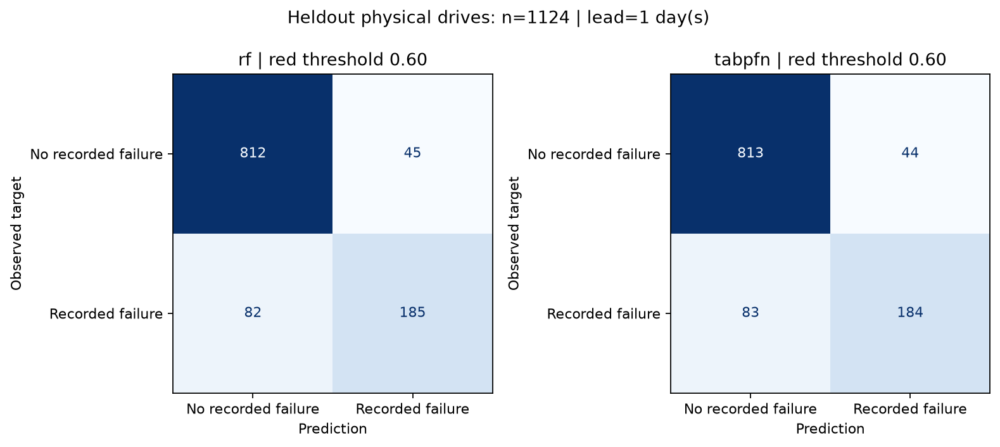

# Disk model: measured evaluation and Person 1 handoff

## Target and evidence

- Target: SMART snapshot exactly **1 day(s) before a recorded failure**.
- Source: [Backblaze Drive Stats](https://www.backblaze.com/cloud-storage/resources/hard-drive-test-data). Raw data, serials and context stay outside Git.
- Sample SHA-256: `c14bd4b2641f1d82b87aa23cdcb0d99295c4bd2f9f640a98fc8cbb2f729da515`; seed `42`.
- Context: 960 unique drives (480 positive). Holdout: 1124 drives (267 positive). No serial overlap.
- Calendar sensitivity check: training snapshot + target horizon <= 2026-05-31; test snapshots > 2026-05-31. Drive identities remain disjoint. Controls were selected retrospectively using quarter outcomes; this is NOT prospective or repair-shop validation.
- Fixed red threshold 0.60, yellow threshold 0.30. Imputation is fitted on context only. Confidence intervals: 300 drive-level bootstrap resamples.
- Negatives have no recorded failure within the available quarter, and were observed at least the target horizon beyond their snapshot. This is not proof of future health.

## Heldout results (red threshold = 0.60)

| Method | Recall (95% CI) | Precision (95% CI) | ROC-AUC (95% CI) | Average precision | Fit s | Holdout batch s |
|---|---|---|---|---|---|---|
| rf | 0.693 (0.644–0.749) | 0.804 (0.760–0.859) | 0.875 (0.847–0.906) | 0.795 | 0.58 | 0.06 |
| tabpfn | 0.689 (0.638–0.745) | 0.807 (0.759–0.860) | 0.879 (0.855–0.910) | 0.806 | 5.57 | 8.72 |

### rf: confusion matrix

| Actual / prediction | Non-red | Red |
|---|---|---|
| No recorded failure | 812 | 45 |
| Recorded failure | 82 | 185 |

| Fixed threshold | Recall | Precision |
|---|---|---|
| 0.30 | 0.779 | 0.630 |
| 0.50 | 0.700 | 0.766 |
| 0.60 | 0.693 | 0.804 |

### tabpfn: confusion matrix

| Actual / prediction | Non-red | Red |
|---|---|---|
| No recorded failure | 813 | 44 |
| Recorded failure | 83 | 184 |

| Fixed threshold | Recall | Precision |
|---|---|---|
| 0.30 | 0.790 | 0.632 |
| 0.50 | 0.745 | 0.724 |
| 0.60 | 0.689 | 0.807 |

## Model availability

- Evaluated selection: **tabpfn**. Set `DD_DISK_MODEL=tabpfn` on the demo laptop.
- RF is the credible classical baseline. No measured result is fabricated for unavailable TabPFN. Default runtime attempts a local checkpoint and warns before using RF.
- TabPFN provisioning: install package, place an official compatible checkpoint at `models/tabpfn-v2-classifier.ckpt` or set `DD_TABPFN_PATH`. Model inference never intentionally downloads weights.
- Tradeoff: TabPFN is retained for the requested local-model demo. Compared with RF, observed recall difference is -0.004 and precision difference is +0.003; compare the CPU batch times above. This is **not evidence of established TabPFN superiority**. Both local paths remain available without API costs.

## How it works (article handoff)

We use Backblaze's daily drive observations to form one snapshot per physical drive. Positive snapshots precede the recorded failure by the stated horizon; controls have no recorded failure in the observed quarter and at least that much follow-up. We freeze a serial-disjoint holdout before evaluation, then retain a bounded training context for each class.

The input consists of five log-transformed SMART error counters, five nonzero flags, temperature and log working hours. Missing values remain missing until a training-only median imputer adds explicit missingness indicators. A classical RandomForest provides the baseline. TabPFN runs locally on CPU with an explicit v2 checkpoint and two estimators; the shared Risk contract records which model actually ran. The saved CSV is the context used to rebuild the model on the demo laptop, not a serialized executable model.

## Honest limitations (copy for the article)

Backblaze data-center HDDs differ from laptop and repair-shop drives. Our sampled case/control mix is enriched for failures: the classifier score is **not a calibrated probability** that a shop customer's drive will fail tomorrow. Random drive-level splitting prevents identity leakage but does not establish performance on future periods or unseen drive models. Missingness and vendor-specific SMART encoding can affect predictions. Some failures have little warning in these counters; a low score is not a safety guarantee and backups remain necessary.

NVMe uses a transparent **heuristic health score**, not the HDD classifier or a measured failure probability. Counter descriptions in `drivers` are observed findings, not causal feature attributions or SHAP explanations. Synthetic NVMe examples are labelled synthetic. Backblaze examples are converted CSV snapshots, not live smartctl captures; demo selection does not measure accuracy.

## Integration for Persons 2 and 3

- Public signatures and shared contracts are unchanged. `load_model()` returns `(classifier, method)`; `parse()` returns `DiskInfo`; ATA uses `predict()`, NVMe uses `nvme_rules.score()`.
- Show **model score** for ATA and **rule-based health score** for NVMe, not a calibrated failure percentage. Customer reports must use the same wording; this requires the owners of `app.py` and `core/report.py`.
- Catch `ValueError` / `FileNotFoundError` at the UI boundary. Do not show green for a failed parse or missing model. A partial NVMe log is at least yellow.
- Copy `models/train_context.csv` to the demo laptop through a private transfer; it is deliberately ignored by Git. Install the recorded dependencies before turning off Wi-Fi.
- Tests: `python -m pytest tests -q` (pytest is a development dependency). These are synthetic boundary/pipeline tests, separate from the real-data metrics above.
- Commands from repo root: `python -m scripts.prepare_backblaze data/data_Q2_2026.zip`; `python -m scripts.train_disk_model --method compare`; `python -m scripts.make_demo_json`.
- Scope: Person 1 modules verified separately; full UI/Gemma flow belongs to Persons 2/3. Live capture evidence, if available, is recorded separately below; these metrics do not imply a Wi-Fi-off UI run or user trial.

## Reproduction environment

- Python 3.13.12; Windows-11-10.0.26200-SP0
- Versions: `{"numpy": "2.5.4", "pandas": "3.0.6", "scikit-learn": "1.9.1", "tabpfn": "9.2.0", "torch": "2.14.1"}`.

## Control sampling and remaining limitations

Sampling rule: serial-hash drive selection; independent serial/date hash selects one eligible snapshot per drive. The largest date group contains **448 of 3000 controls (2026-05-10)**. Snapshots are limited to selected observation days, not all daily observations. This is still a retrospective case/control experiment; prospective temporal and repair-shop validation remain necessary.

| Control snapshot date | Drives |
|---|---|
| 2026-04-01 | 400 |
| 2026-04-14 | 431 |
| 2026-04-27 | 429 |
| 2026-05-10 | 448 |
| 2026-05-22 | 435 |
| 2026-06-04 | 422 |
| 2026-06-17 | 435 |

- Local TabPFN checkpoint SHA-256: `f65a35685aeef42e31b796d9bfa34e68d6fc780bc98e7bff7763802964cf435f`.
- Checkpoint source: [official Prior Labs TabPFN-v2-clf](https://huggingface.co/Prior-Labs/TabPFN-v2-clf). Weights have their own model license, separate from this repository's MIT code license.

