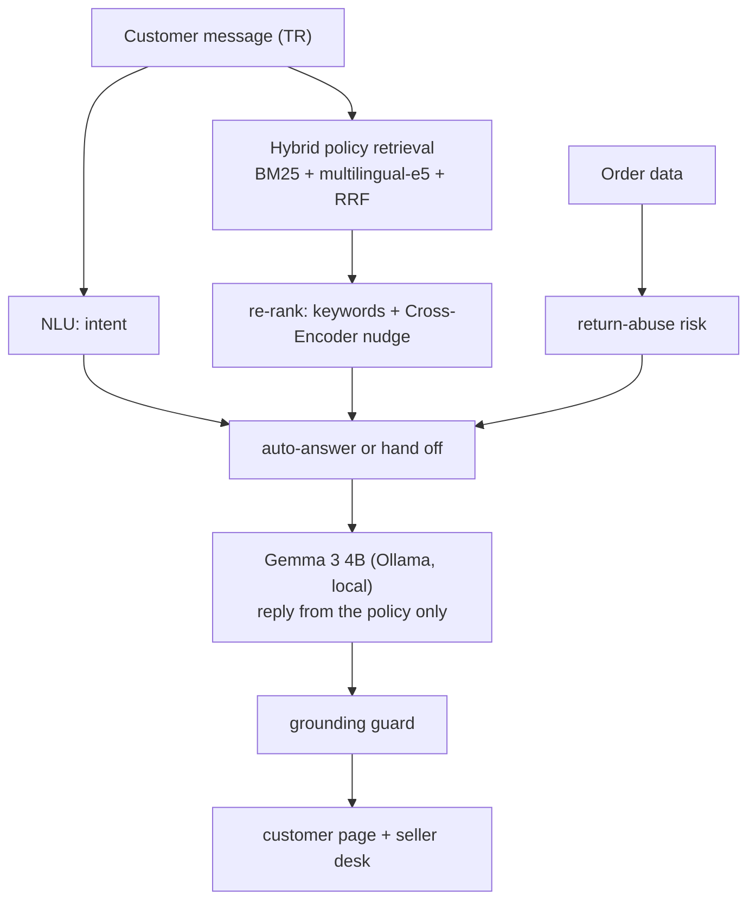

## 1. The Problem: "Where Is My Parcel?" … Six Hours Later

You order a leather bag from a small shop on Trendyol. Two days pass, nothing moves, so you write to the seller: *"Kargom nerede?"* The answer comes in the evening — if it comes at all.

On the other side is one person who packs every order, answers Trendyol, Hepsiburada and Instagram messages, and handles returns. Most questions are routine ("can I swap the size?", "I was charged twice", "when will my refund arrive?"), but they pile up. Slow answers lower the store score. Rushed answers are worse: approve every refund and you pay for worn shoes with cut-off tags; quote a rule that isn't the store's rule and you start a dispute.

**EsnafDoktor answers the routine questions in about two seconds and hands the risky ones to the seller** — using an open-weight model that runs on the seller's own computer, at 0 TL per message.

---

## 2. Why Open Weights and Local Inference

| | Closed API (per-message pricing) | EsnafDoktor (open weights, local) |
| :--- | :--- | :--- |
| **Cost** | grows with every message | **0 TL per message** on the laptop the shop already has |
| **Customer data (KVKK)** | names, addresses and orders leave the country | **stays on the seller's disk** |
| **Internet** | no connection, no answers | inference is local; works with Wi-Fi off once models are downloaded |
| **Lock-in** | provider sets price and model | **swap the model** from the seller desk (Gemma, Qwen, Llama…) |

---

## 3. What We Built

Every customer message goes through four steps:



**1. Find the store's rule.** Sixteen Turkish e-commerce policies (shipping delays, damaged parcels, 14-day withdrawal, used-item refusals, double charges…). Retrieval fuses Turkish-normalised BM25 with `multilingual-e5-small` via Reciprocal Rank Fusion, then re-ranks with the policy keywords and a multilingual Cross-Encoder used as a *weight*, not a judge.

**2. Score the risk.** Order amount, delivery days, return history, unboxing video and damage report feed a risk model. TabPFN is integrated; recent TabPFN versions need a one-time PriorLabs license acceptance to download weights, so until then a calibrated logistic formula on the same five features runs, and the health endpoint says so.

**3. Decide who answers.** Routine questions are answered immediately. Angry messages, high-risk orders and used-item refunds get a short "I've forwarded this to the shop owner" reply and land in the seller's inbox. For damage and defect claims the assistant asks for photos and also forwards the case. **The model never approves or refuses a refund.**

**4. Write the reply — and check it.** Gemma 3 4B writes at most three sentences, using only the matched policy. Then a simple guard runs: every number in the reply (days, amounts, codes) must appear in the policy or the customer's message. If not, the reply is regenerated once with a stricter instruction; if it still fails, the rule-based template is sent. During development this guard caught a model promising *"your return window is 7 days"* — a number that exists nowhere in the store's rules.

**The interface** is plain HTML/CSS/JS served by FastAPI:
- **Customer page** — product page with a "Satıcıya sor" chat and a review form. Each message shows (for the jury) its classification, the policy it was based on, and whether it was handed off.
- **Seller desk** — inbox of auto-answered and escalated messages, order ledger, risk stamp with drivers, action checklist, policy citation and an editable draft written by the local model. Keyboard driven (J/K, E). An optional voice summary reads the decision aloud, skipping policy codes and order numbers.

---

## 4. Measured Results (and What Isn't There Yet)

Every number below is produced by a script in the repo (`scripts/evaluate_honest_metrics.py`, `scripts/evaluate_rag_policy.py`).

| What | Result |
| :--- | :---: |
| Category accuracy, 20-case held-out set | **95.0 %** (macro F1 93.8 %) |
| Exact policy Hit@1, 21 colloquial messages | **95.2 %** |
| — BM25 alone / E5 alone / RRF | 81.0 % / 71.4 % / 81.0 % |
| — Cross-Encoder as the only re-ranker | 17/21 |
| Replies passing the grounding guard (Gemma 3 4B) | 8/8 on first try |
| Analysis time (warm, CPU) | ~0.46 s |
| Reply time (warm, Gemma 3 4B on GPU, 2.9 GB VRAM) | ~1.4 s |

The Cross-Encoder result surprised us: on short Turkish policies its scores are almost flat, and letting it decide alone made retrieval *worse*. Used as a small weight on top of keyword and semantic scores, it fixes the last few cases.

**Not there yet, said plainly:**
- Our fine-tuned BERTurk classifiers are not in the repo, so the NLU runs a keyword fallback (60 % category accuracy alone). That's why the interface takes the category from the matched policy.
- TabPFN needs the license step described above.
- Browser speech-to-text in Chrome/Edge sends audio to the vendor; reading replies aloud is local.

---

## 5. What the Demo Shows

1. The customer asks *"Kargom 5 gündür gelmedi, nerede?"* — in about two seconds Gemma answers from the shipping-delay policy (standard delivery 1–3 business days, a tracking complaint after 4), and the chips show *Kargo · Şikâyet · POL_KARGO_01*.
2. The customer writes *"Rezalet! Çantayı bir kere kullandım, etiketini de kestim, paramı hemen verin"*. The assistant does **not** promise a refund: it replies that the message was forwarded, and a *"Mağaza sahibine iletildi · Acil"* note appears.
3. In the seller desk that message is at the top of the inbox with its risk stamp, the matched used-item policy, a checklist and a draft reply the seller can regenerate with the local model and approve.

---

## 6. Open Source

* **Best Use of Gemma:** Gemma 3 4B runs locally through Ollama and writes every customer reply, bounded by the store's policy and checked by the grounding guard.
* **Best Open-Source AI Project:** MIT licensed, open-weight models only, no external API calls for inference.
* **Best Use of TabPFN:** integrated for return-abuse risk; enabled with `ED_USE_TABPFN=1` after the license step.

### Reproduction
* **Repository:** [github.com/hacktob3v-devs/disk-doctor (branch `esnaf-doktor`)](https://github.com/hacktob3v-devs/disk-doctor/tree/esnaf-doktor)
* **License:** MIT

```bash
git clone -b esnaf-doktor https://github.com/hacktob3v-devs/disk-doctor.git esnaf-doktor
cd esnaf-doktor
pip install -r requirements.txt
ollama pull gemma3:4b
pytest tests/ -v
python server.py          # http://127.0.0.1:8000  and  /satici.html
```

Open weights, store-specific rules and zero per-message cost — so the small seller can answer as fast as the big ones.
